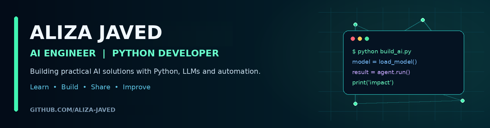



# Hi, I'm Aliza Javed 👋

### AI Engineer &nbsp;|&nbsp; Python Developer &nbsp;|&nbsp; Generative AI

*Building intelligent solutions with Python, LLMs and automation. Turning ideas into real-world impact.*

---

## 👩‍💻 About Me

I'm an **AI Engineer and Python Developer** who builds AI-powered applications using Large Language Models (LLMs), RAG systems, AI agents and automation tools. I enjoy solving real-world problems with technology and I'm open to **remote and international opportunities**.

- 🔭 Working on: RAG systems, AI agents and LLM applications
- 🌱 Learning: advanced Generative AI, agent frameworks, deployment
- 🤝 Open to: remote roles, freelance AI projects, open-source collaboration
- 📫 Reach me: see links above

> *"Technology is not just about code, it's about creating opportunities."*

---

## 🛠️ Technical Skills

**Languages**

**AI / Machine Learning**

**Backend & APIs**

**Databases & Cloud**

**Tools & DevOps**

> ✏️ Sirf wohi skills rakhein jo aapko actually aati hain. Baqi badges delete kar dein.

---

## 🚀 Featured Projects

| Project | Description | Tech |
|---|---|---|
| **[Resume RAG System](https://github.com/aliza-javed/REPO-NAME)** | Resume analysis using Retrieval-Augmented Generation to extract skills and match them with job descriptions. | Python, LangChain, FAISS, FastAPI |
| **[ClaimCare](https://github.com/aliza-javed/REPO-NAME)** | Healthcare claims management application with secure, user-friendly workflows. *(No private or patient data is published.)* | Django, PostgreSQL |
| **[AI Engineering Journey](https://github.com/aliza-javed/REPO-NAME)** | Hands-on learning path: notes, projects and resources for AI, Python and automation. | Python, Jupyter |

---

## 📊 GitHub Stats

---

## 🎯 My Goal

To grow as an AI Engineer, work on meaningful projects, contribute to open source and collaborate with global teams on innovative solutions.

**Learn • Build • Share • Improve**

⭐ Thanks for visiting! If you like my work, drop a star on a repo.

